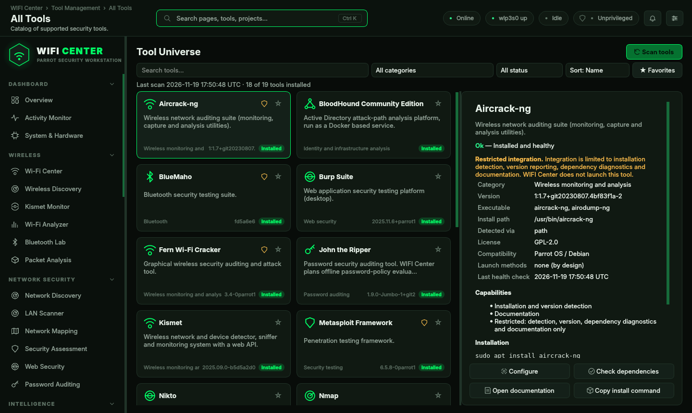

# WIFI Center

A security workstation and system manager for **Parrot OS**, written in Python with Qt (PySide6). It puts wireless and Bluetooth analysis, scoped network
discovery, assessment projects and reports, OSINT research, a tool manager and Parrot maintenance in one application.

> **Release candidate (1.0.0rc1).** Everything shown is real data from your own system; nothing is simulated. Some parts, notably Bluetooth pairing, GATT
> access and packet capture on real hardware, have so far been tested only against simulations and synthetic data. Pages say so where it applies.

**Use it only on networks and devices you own or are explicitly authorised to test.**



## What is in it

| Area | What you get |
|---|---|
| **Wireless** | Adapter manager, Wi-Fi discovery with live radar and channel charts, Wi-Fi analyzer, Kismet monitor |
| **Bluetooth Lab** | Adapter diagnostics, scanner, signal monitor, device manager (pairing agent), inspector, BLE explorer (read-only by default, guarded writes), security auditor, packet analyzer (btmon + built-in decoder), inventory and reports |
| **Network security** | Scoped network discovery with evidence-based topology, LAN scanner, assessment projects with authorised scope, findings, evidence integrity, project history and HTML/PDF/JSON/CSV reports |
| **Intelligence** | OSINT workspace, wordlist library, local resources, offline documentation reader |
| **System** | Tool manager (detects, never silently installs), package manager with simulate-first transactions, software updates, cleanup, system information |
| **Privileged helper** | A small Polkit-guarded service that validates every request, re-simulates package changes as root, and keeps a hash-chained audit log. The app itself runs as your normal user. |

More screenshots: [assessment](docs/screenshots/assessment.png) · [reports](docs/screenshots/reports.png) · [project history](docs/screenshots/project_history.png) · [documentation](docs/screenshots/docs.png).
The overview dashboard is not shown because it lists the devices on the machine's real network.

## Safety principles

* Scope is enforced in code (authorised targets, attached private networks, size limits), not just in the interface.
* Anything that changes state or touches a device asks first and names the target.
* Findings keep their evidence and distinguish **confirmed** from **observation** (declared, not tested) from **unknown**.
* Pairing keys, PINs and capture secrets are never stored or logged; key material is redacted on screen and in exports.
* No tool is installed or launched behind your back; restricted integrations are detection and documentation only.

## Install (Parrot OS / Debian)

Download the package from the project's releases page, then:

```bash
sudo apt install ./wifi-center_1.0.0rc1_all.deb
```

Or use the installer, which downloads the latest release, verifies its SHA-256 and installs it with apt (read it first if you prefer):

```bash
curl -fsSL https://raw.githubusercontent.com/unupunct/Parrot-OS-Security-Workstation/main/install.sh | sudo bash
```

No network on the target machine? Use the offline bundle `wifi-center-offline-<version>.tar.gz` (`sudo ./install-offline.sh`; see its `README-INSTALL.txt`).
Parrot OS 7 already ships all dependencies. Remove with `sudo apt remove wifi-center` (the helper's audit log and your data are kept).

Start it from the application menu or run `wifi-center`. Privileged actions ask for your administrator password through Polkit; see [Root access](docs/ROOT_ACCESS.md).

> The installer and release links work once a release has been published on GitHub. The checksum protects against a damaged download; it cannot prove who published
> a release, so install only from a source you trust.

## Run from source

```bash
sudo apt install python3-pyside6.qtcore python3-pyside6.qtgui python3-pyside6.qtwidgets python3-pyqtgraph python3-psutil python3-dbus python3-gi
python3 main.py
```

On other systems: `pip install -r requirements.txt && python main.py` (the Linux-specific pages need Linux).

## Build the packages

```bash
python packaging/build_release.py      # dist/release: .deb, offline bundle, install.sh, SHA256SUMS
python -m pytest                       # test suite
```

The .deb builder is pure Python (no `dpkg-deb` needed) and reproducible. Nothing is uploaded by these commands.

## Documentation

[Root access](docs/ROOT_ACCESS.md) · [Bluetooth Lab](docs/BLUETOOTH_LAB.md) · [Projects, evidence and reports](docs/PROJECTS_AND_REPORTS.md) ·
[Network security](docs/NETWORK_SECURITY.md) · [Wireless](docs/WIRELESS.md) · [Parrot OS manager](docs/PARROT_OS_MANAGER.md) · [OSINT](docs/OSINT_GUIDE.md) ·
[Tool integrations](docs/TOOL_INTEGRATIONS.md) · [Wordlist library](docs/WORDLIST_LIBRARY.md) · [UI design](docs/UI_DESIGN.md). The same guides are readable inside the app (Documentation).

## Licence

MIT. See [LICENSE](LICENSE).
